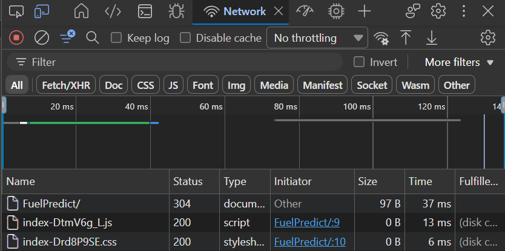

# FuelPredict

FuelPredict ist eine Webanwendung zum Vergleichen von Tankstellenpreisen. Über Ort, Kraftstoffart und Suchradius lassen sich Tankstellen suchen. Geplant sind außerdem Preisverläufe und Prognosen zur Preisentwicklung.

## Funktionen

- Tankstellen nach Ort oder aktuellem Standort suchen.
- Kraftstoff und Suchradius auswählen.
- Ergebnisse nach Preis oder Entfernung sortieren.
- Nach geöffneten Tankstellen filtern und eine Route öffnen.

## Projekt

- **Team:** Einzelprojekt
- **Datenquelle:** [Tankerkönig](https://creativecommons.tankerkoenig.de/)
- **Technik:** HTML, JavaScript
- **Repository:** [FuelPredict](https://github.com/FaisonHD/FuelPredict)

## Projektideen

1. **FuelPredict:** Tankstellen und Kraftstoffpreise vergleichen. Datenquelle: Tankerkönig.
2. **WeatherCompare:** Wetter verschiedener Orte vergleichen. Datenquelle: Open-Meteo.
3. **BikeStationFinder:** Verfügbare Leihfahrräder und Stationen anzeigen. Datenquelle: GBFS.
4. **AirQualityMap:** Luftqualitätswerte verschiedener Messstationen vergleichen. Datenquelle: OpenAQ.
5. **PublicHolidayPlanner:** Feiertage nach Land und Jahr anzeigen. Datenquelle: Nager.Date.

### Auswahl

Ich habe mich für FuelPredict entschieden, weil ich Tankpreise im Alltag selbst vergleichen möchte und sich die Daten gut für Filter, Preisverläufe und spätere Prognosen eignen.

- **WeatherCompare:** Wetterinformationen sind bereits in vielen Apps gut verfügbar.
- **BikeStationFinder:** Die Daten hängen stark vom jeweiligen Standort und Verleihsystem ab.
- **AirQualityMap:** Die verschiedenen Messwerte sind schwieriger auszuwerten und zu vergleichen.
- **PublicHolidayPlanner:** Feiertage ändern sich selten und bieten weniger Möglichkeiten für Auswertungen.

## Maschinenlesbarkeit

Die Datei `llms.txt` beschreibt das Projekt. In `index.html` sind strukturierte Daten nach `schema.org/WebApplication` eingebunden.

### Google Rich Results Test

Am 22.10.2026 hat der Google Rich Results Test ein gültiges Software-App-Element erkannt. Es wurden keine kritischen Probleme festgestellt.


## Gestaltung

Die Oberfläche verwendet eine gemeinsame Farbpalette, abgerundete Karten und ein responsives Raster. Navigation und Aktionsleiste nutzen Flexbox, die Seitenaufteilung CSS Grid. Ab 768 px werden die Inhalte zweispaltig dargestellt.

Wiederverwendete Bausteine:
- **Buttons:** Suche und Zurücksetzen im Formular (`.btn`).
- **Karten:** Suche, Ergebnisse und Infobereiche (`.card`).
- **Navigation:** Links im Kopfbereich (`nav a`).

### CSS und Tailwind

Unter „Karten im Vergleich“ stehen eine mit `.compare-card` gestaltete Karte und eine Karte mit Tailwind-Utilities. Beispielsweise entsprechen `p-4` dem Innenabstand, `rounded-xl` den abgerundeten Ecken und `border` dem Rahmen.

### CSS-Kaskade

Die Regeln `nav a` und `nav a:hover` treffen beim Darüberfahren denselben Link. `nav a:hover` gewinnt aufgrund der höheren Spezifität (0-1-2 gegenüber 0-0-2).

## Online-Version

GitHub Pages: https://faisonhd.github.io/FuelPredict/

Die Veröffentlichung erfolgt automatisch über GitHub Actions nach einem Push auf `main`. Für die erstmalige Aktivierung muss unter **Settings → Pages → Build and deployment** die Quelle **GitHub Actions** ausgewählt sein.

### Browser-Tests

Die veröffentlichte Version wurde im Browser mit Lighthouse und dem Network-Tab geprüft.

| Lighthouse-Kategorie | Ergebnis |
| --- | ---: |
| Leistung | 100/100 |
| Barrierefreiheit | 96/100 |
| Best Practices | 100/100 |
| SEO | 90/100 |
| Agentisches Browsing | 2/2 |

Damit ist die geforderte Barrierefreiheitsbewertung von mindestens 90 Punkten erreicht.


Im Network-Tab waren beim dokumentierten Seitenaufruf keine HTTP-Fehler (4xx oder 5xx) sichtbar. Das HTML-Dokument antwortete mit 304 (nicht verändert), JavaScript und CSS mit 200 (OK).



### Lokal und live prüfen

Der dokumentierte Live-Test bestätigt, dass HTML, JavaScript und CSS unter dem GitHub-Pages-Projektpfad geladen werden.

- Vite baut die Dateien nach `dist/`; produktive Dateien werden über den Projektpfad ausgeliefert.
- GitHub Actions veröffentlicht den Build statt des Quellordners.
- Die Tankstellensuche benötigt zusätzlich das serverseitige `/api/stations`-Backend; GitHub Pages allein kann dieses nicht ausführen.

Ein eigener Server ist nötig, wenn geheime API-Schlüssel oder serverseitige Verarbeitung benötigt werden. GitHub Pages reicht für statische HTML-, CSS- und JavaScript-Dateien.

## Entwicklung

```bash
npm install
npm run dev
npm run build
```

Vite erstellt beim Build den Ordner `dist/` mit den für die Veröffentlichung benötigten Dateien. `node_modules/` und `dist/` sind in `.gitignore` eingetragen. Die Styles werden mit Tailwind CSS 4 und dem Vite-Plugin erzeugt; nur verwendete Utility-Klassen werden in die gebaute CSS-Datei übernommen.

## KI-Log

- 17.11.2026 – ChatGPT: Abgleich mit Übungsblatt 5 und 6, Auslagerung der Suchlogik und Speicherung der Filtereinstellungen. Die Änderungen wurden im Repository überprüft, ein Browser-Test steht noch aus.
- 17.11.2026 – ChatGPT stufte das Deployment zunächst als erledigt ein. Beim Lesen des Quellcodes fiel auf, dass `/api/stations` serverseitig ausgeführt werden muss und GitHub Pages dies nicht unterstützt. Die Bewertung gilt deshalb nur für die statische Oberfläche, nicht für die gesamte Anwendung.
