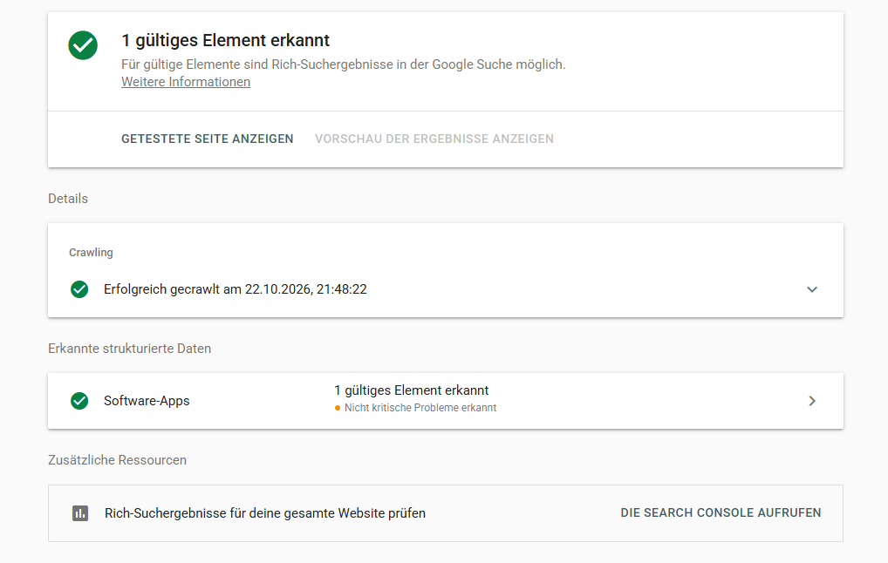

# FuelPredict

FuelPredict ist eine Webanwendung zum Vergleichen von Tankstellenpreisen. Über Ort, Kraftstoffart und Suchradius lassen sich Tankstellen suchen. Geplant sind außerdem Preisverläufe und Prognosen zur Preisentwicklung.

## Projekt

- **Team:** Einzelprojekt
- **Datenquelle:** [Tankerkönig](https://creativecommons.tankerkoenig.de/)
- **Technik:** HTML, JavaScript
- **Repository:** [FuelPredict](https://github.com/FaisonHD/FuelPredict)

## Projektideen

1. **FuelPredict:** Tankstellen und Kraftstoffpreise vergleichen. Datenquelle: Tankerkönig.
2. **WeatherCompare:** Wetter verschiedener Orte vergleichen. Datenquelle: Open-Meteo.
3. **BikeStationFinder:** Verfügbare Leihfahrräder und Stationen anzeigen. Datenquelle: GBFS.
4. **AirQualityMap:** Luftqualitätswerte verschiedener Messstationen vergleichen. Datenquelle: OpenAQ.
5. **PublicHolidayPlanner:** Feiertage nach Land und Jahr anzeigen. Datenquelle: Nager.Date.

### Auswahl

Ich habe mich für FuelPredict entschieden, weil ich Tankpreise im Alltag selbst vergleichen möchte und sich die Daten gut für Filter, Preisverläufe und spätere Prognosen eignen.

- **WeatherCompare:** Wetterinformationen sind bereits in vielen Apps gut verfügbar.
- **BikeStationFinder:** Die Daten hängen stark vom jeweiligen Standort und Verleihsystem ab.
- **AirQualityMap:** Die verschiedenen Messwerte sind schwieriger auszuwerten und zu vergleichen.
- **PublicHolidayPlanner:** Feiertage ändern sich selten und bieten weniger Möglichkeiten für Auswertungen.

## Maschinenlesbarkeit

Die Datei `llms.txt` beschreibt das Projekt. In `index.html` sind strukturierte Daten nach `schema.org/WebApplication` eingebunden.

### Google Rich Results Test

Am 22.10.2026 hat der Google Rich Results Test ein gültiges Software-App-Element erkannt. Es wurden keine kritischen Probleme festgestellt.



## Gestaltung

Die Oberfläche verwendet eine gemeinsame Farbpalette, abgerundete Karten und ein responsives Raster. Navigation und Aktionsleiste nutzen Flexbox, die Seitenaufteilung CSS Grid. Ab 768 px werden die Inhalte zweispaltig dargestellt.

Wiederverwendete Bausteine:
- **Buttons:** Suche und Zurücksetzen im Formular (`.btn`).
- **Karten:** Suche, Ergebnisse und Infobereiche (`.card`).
- **Navigation:** Links im Kopfbereich (`nav a`).

### CSS und Tailwind

Unter „Karten im Vergleich“ stehen eine mit `.compare-card` gestaltete Karte und eine Karte mit Tailwind-Utilities. Beispielsweise entsprechen `p-4` dem Innenabstand, `rounded-xl` den abgerundeten Ecken und `border` dem Rahmen.

### CSS-Kaskade

Die Regeln `nav a` und `nav a:hover` treffen beim Darüberfahren denselben Link. `nav a:hover` gewinnt aufgrund der höheren Spezifität (0-1-2 gegenüber 0-0-2).

## Online-Version

GitHub Pages: https://faisonhd.github.io/FuelPredict/

Die Veröffentlichung erfolgt automatisch über GitHub Actions nach einem Push auf `main`. Für die erstmalige Aktivierung muss unter **Settings → Pages → Build and deployment** die Quelle **GitHub Actions** ausgewählt sein.

### Lokal und live prüfen

Nach dem ersten erfolgreichen Deployment die lokale und die veröffentlichte Version nebeneinander öffnen und im Browser unter **DevTools → Network** auf fehlgeschlagene Requests prüfen. Drei konkrete Beobachtungen und ihre Ursachen hier ergänzen, sobald beide Versionen getestet wurden.

## Entwicklung

```bash
npm install
npm run dev
npm run build
```

Vite erstellt beim Build den Ordner `dist/` mit den für die Veröffentlichung benötigten Dateien. `node_modules/` und `dist/` sind in `.gitignore` eingetragen. Die Styles werden mit Tailwind CSS 4 und dem Vite-Plugin erzeugt; nur verwendete Utility-Klassen werden in die gebaute CSS-Datei übernommen.
